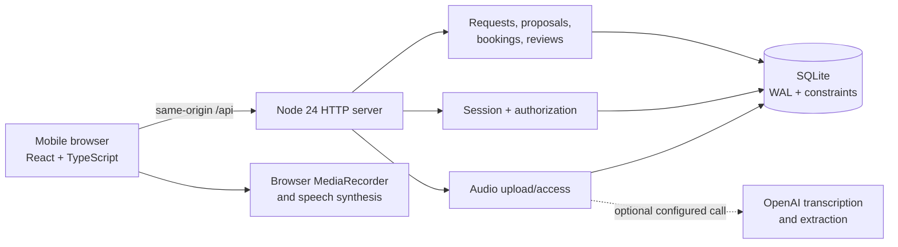
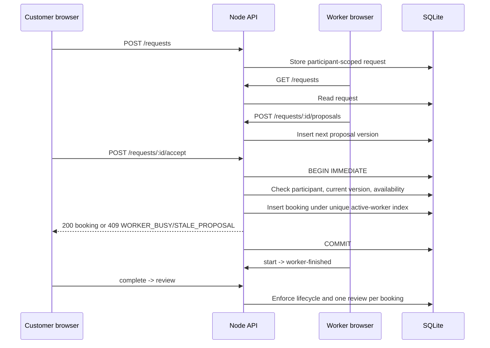
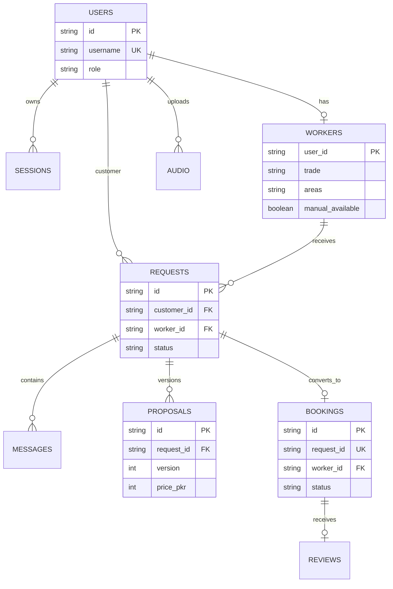

# Roshan Rozgar (روشن روزگار)

Roshan Rozgar is a mobile-first, voice-assisted local marketplace for workers
and households in Islamabad and Rawalpindi. It is a local MVP built with
React, TypeScript, Vite, Node 24's HTTP server and SQLite.

## Run locally

Requirements: Node.js 24 or newer.

```sh
npm install
npm run check
npm run dev
```

Open the Vite URL printed by the web process. The API runs on port 3001 by
default and the Vite development server proxies `/api` requests to it. For a
production-style local run:

```sh
npm run build
npm start
```

The local database is `data/roshan.sqlite`. Set `DATABASE_PATH` to use another
database. Copy `.env.example` to `.env` for optional configuration; never
commit `.env`.

## What is functional

- Server-side account registration/login with HttpOnly session cookies.
- Worker profile creation, manual confirmation, service areas and persisted
  availability.
- Public area/trade discovery with availability computed from persisted
  bookings.
- Participant-only requests, text messages and private voice notes.
- Real browser recording and preview when microphone permissions are
  available.
- Optional server-side Urdu transcription and grounded profile extraction
  through OpenAI. The draft always requires worker confirmation.
- Versioned worker proposals, explicit customer acceptance, idempotent
  confirmation and a database uniqueness guard against double booking.
- Worker start/finish, customer completion and one authorized persisted review.

## AI and fallback disclosure

AI is not silently simulated. Without `OPENAI_API_KEY`, profile transcription
returns a clear configuration error and the worker can use the editable manual
profile form. Browser speech synthesis is only used for read-aloud feedback;
if an Urdu voice is unavailable, the UI says so rather than pretending audio
played.

The SQLite database may contain local demo data. It is not a government
identity verification source, and the product does not claim verification
badges, exact distances or payment processing. See
[`docs/DEMO_SCRIPT.md`](docs/DEMO_SCRIPT.md) for the complete two-role demo.

## Verification

```sh
npm run typecheck
npm test
npm run build
```

`npm run check` runs all three commands. The tests cover authorization,
private audio, proposal versioning, booking races, idempotent retries,
completion, review eligibility and persisted availability.

## Provenance and credits

The supplied Figma Make export is preserved as provenance in
[`docs/reference`](docs/reference). Its source prototype is not treated as a
functional backend. No external credentials or private assets are included.
The product requirements are documented in [`docs/PRD.md`](docs/PRD.md).

## Architecture

The application deliberately keeps business rules and authorization on the
server. The browser only renders state returned by the API; it cannot assign
itself a worker/customer role or complete a booking directly.



### Request and booking flow



### Data model



## Security review and controls

The security review for this release found no actionable vulnerabilities.
The review verified:

| Area | Control |
|---|---|
| Authentication | Scrypt password hashes, hashed session tokens, HttpOnly/SameSite cookies, expiry |
| Authorization | Server-side role checks and participant checks for requests, messages, audio, bookings and reviews |
| Booking integrity | SQLite transaction, active-worker unique index, proposal version check and idempotency key |
| Audio privacy | Owner/participant access checks, MIME and container validation, 5 MB request limit, per-user quota |
| Input safety | Bounded fields, allow-listed trades/areas, parameterized SQL, React escaping |
| Browser boundary | Same-origin validation for state-changing requests and `nosniff` response headers |
| Dependencies | `npm audit --omit=dev` reported zero high production vulnerabilities during review |

This is a local MVP, not a production deployment assessment. Before exposing it
publicly, add TLS/reverse-proxy hardening, centralized rate limiting, backup
and restore procedures, structured audit logging, secret rotation, and an
external penetration test.

## Test and verification matrix

| Command or check | Coverage |
|---|---|
| `npm run typecheck` | TypeScript correctness |
| `npm test` | Auth, profile persistence, discovery, private audio, agreement, concurrency, lifecycle and reviews |
| `npm run build` | Production Vite bundle |
| `npm run check` | All three checks above |
| `curl http://127.0.0.1:3001/api/health` | API readiness and AI configuration disclosure |
| `curl -I http://127.0.0.1:5173/` | Web server readiness |
| `npm audit --omit=dev` | Production dependency advisory scan |

The API and Vite processes must each have an available port. If `3001` or
`5173` is already occupied, stop the existing process or set `PORT` for the
API and configure the Vite proxy to match before starting a second instance.
An `EADDRINUSE` message means another instance is already listening; it is not
an application-level test result.

## URL routing

The UI uses the browser History API rather than a third-party router. These
routes are supported and survive refresh:

| Route | Purpose |
|---|---|
| `/` | Welcome page |
| `/discover` | Customer worker discovery |
| `/workers/:id` | Public worker profile |
| `/auth/customer` | Customer sign-in/register |
| `/auth/worker` | Worker sign-in/register |
| `/profile` | Authenticated worker profile editor |
| `/jobs` | Authenticated request list |
| `/requests/:id` | Authenticated participant conversation |

The Node server falls back to the built `index.html` for non-API paths, so
direct links work in the production-style server as well as Vite development.
Server authorization still protects authenticated routes and request data;
the URL is only navigation state, never a permission boundary.

## Repository map

```text
src/                 React UI, API client, recorder and styles
server/              Node HTTP routes, SQLite schema, audio and bookings
tests/               Node integration/security-focused tests
data/                Local SQLite runtime files (ignored by Git)
docs/PRD.md          Product requirements
docs/DEMO_SCRIPT.md  Reproducible judge/demo flow
docs/reference/      Supplied prototype provenance
scripts/dev.mjs      Concurrent API + Vite development runner
```

## Known limitations

- Live transcription and structured extraction require `OPENAI_API_KEY`; the
  manual profile route remains available when it is absent or unavailable.
- Sessions use local SQLite and one process's in-memory rate limiter; deploy
  behind a hardened reverse proxy and shared rate-limit/session strategy for
  multi-instance production use.
- There are no payments, maps, push notifications, government verification,
  exact distance claims or native mobile clients.
