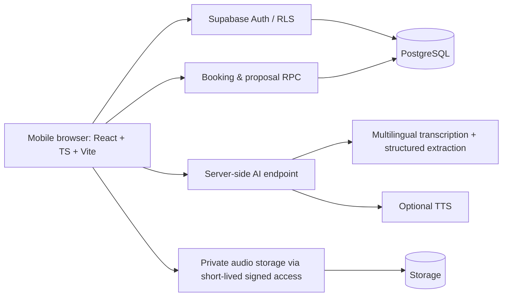

# Roshan Rozgar (روشن روزگار) — Product Requirements Document

**Version:** 1.0 — Hackathon MVP  
**Date:** 10 November 2026  
**Event:** COMSATS University Islamabad — CUI Tech Fest, AI Web Forge  
**Status:** Proposed requirements; **not** a claim that functionality has been implemented or tested  
**Primary source:** `Roshan_Rozgar_Problem_Statement.pdf` (3 pages)  
**Related design reference:** https://www.figma.com/make/hw5AvfkSQkFI4kJ1Kx8YhJ/Project-Task-Organizer?t=6BaeWZdQtyeGJeMI-1 (Figma Make, content not independently inspected)  
**Workspace for local Codex:** `/Users/hf/Documents/CUI-Web` (not accessible from this chat environment)

## 1. Executive summary

Roshan Rozgar is a mobile-first, voice-first, hyperlocal marketplace connecting households in Islamabad/Rawalpindi with independent electricians, plumbers, AC technicians, carpenters, and mechanics. The primary differentiator is **spoken Urdu onboarding**: a worker speaks about their work, AI transcribes and structures a draft profile, the draft is read back, and the worker corrects or confirms it using voice and large tap targets. A customer discovers a relevant available worker, exchanges accessible voice messages, accepts a specific labour/total price and materials scope, confirms a conflict-safe immediate booking, and later gives genuine feedback.

The system uses **AI for language interpretation**, **people for consent**, and **the database for business rules**. It does not claim government verification or invent information.

## 2. Source requirements and assumptions

### Directly required by the supplied problem statement
1. Worker onboarding without conventional text-heavy signup.
2. Nearby, currently available worker discovery.
3. Accessible job and price communication/agreement.
4. Booking with consistent worker availability.
5. After-job reputation information.

A browser-based mobile-usable full-stack application with meaningful applied AI is expected. Urdu/Roman Urdu is encouraged. Maps, full chat, and voice are possible implementation choices, not individually mandatory. Payments, native apps, and government-database identity verification are outside scope. Public Git repository, demo (live deployed or working locally), README disclosures and demo/Q&A are required. Project-specific work must begin during the official hacking window.

### Team decisions, not independently verified as organizer rules
- A separate Figma deliverable is due **12:00 PM**, reportedly per team communications; **not in the supplied PDF**.
- The final full-app submission deadline and accepted Figma format must be confirmed with organizers.
- A Figma Make prototype is not automatically an editable Figma Design file; confirm whether a view-only Make link, a Design link or a `.fig` export is accepted.
- Implementation uses existing suitable code if available; otherwise React + TypeScript + Vite + Tailwind + Supabase PostgreSQL/Auth/private Storage + server-side AI.

## 3. Vision, value proposition and success definition

**Vision:** Make a trustworthy local livelihood marketplace accessible to workers who are skilled but not comfortable reading or typing.

**Core value for workers:** Publish a useful profile and get local work without writing a CV, uploading certificates or navigating complicated forms.

**Core value for customers:** See who can do the job, serves their area and is free now; agree the price before booking; evaluate actual past reviews.

**Hackathon success (all P0):** A real Urdu voice recording produces an editable profile; a customer can find that worker; both parties can exchange a useful voice note or accessible equivalent; a worker proposes an explicit scope/price and the customer accepts; booking persists for both roles; a simultaneous competing confirmation is rejected; completion and one review persist and affect reputation.

**Performance measures (if feasible):** worker signup completion time, taps, number of manual text entries (target zero for core worker path), fields correctly extracted from real Urdu audio, profile correction rate, booking-conflict test passing, and mobile usability at 360px width. No fabricated measurements.

## 4. Personas

**W1 — Aslam, electrician:** Reads little English, uses an entry-level Android phone, speaks Urdu/Potohari/Roman Urdu, intermittently connected, needs voice prompts and big buttons.

**C1 — Household customer:** Has a broken ceiling fan, is in a specific neighbourhood, needs a trustworthy, available electrician and an agreed price.

**C2 — Competing household customer:** Requests the same electrician and exposes overbooking risk.

## 5. MVP boundaries

| Priority | Included | Excluded/deferred |
|---|---|---|
| P0 | Worker voice-assisted onboarding, areas/trades, persistent profiles | Long CV fields, document verification |
| P0 | Area + trade search, availability explanation | GPS dependency, full maps, unverified km distance |
| P0 | Shared accessible communication, voice playback where feasible, price proposal with explicit acceptance | Generic chatbot; complex real-time messaging infrastructure |
| P0 | Conflict-safe immediate booking, lifecycle, persisted state, role-based permissions | Payments, future scheduling, multi-worker jobs |
| P0 | Completion + single eligible customer review, persisted rating count | Purchased/fake reviews, verification badges |
| P1 | Urdu/Roman Urdu/English switch, dynamic spoken readback, robust audio error handling | Highly polished localization of every edge case |
| P2 | Voice reviews, auto-category suggestion from customer audio, maps, push notifications | Native mobile applications |

**Scope rule:** Finish and test P0 end to end before P1/P2. No feature is called complete without end-to-end evidence.

## 6. User journeys

### 6.1 Worker onboarding (signature moment)
1. Select **I am a worker** and trade icon (e.g., electrician).
2. Hear a short Urdu spoken prompt: name, years of experience, services.
3. Record (permission handling, live/stop state, playback and retry), then submit audio.
4. Backend transcribes actual audio; structured extraction returns candidate `{name, trade, years_experience, services}` with explicit missing/uncertain fields.
5. Pick served neighbourhood(s) from large, bilingual choices.
6. Hear the **actual draft** read back. Any wrong/missing field must be correctable by recording again or selecting a control; never auto-invent missing details.
7. Tap **Publish profile**. Persist profile and mark worker manually available.

Fallback: clear 'Could not understand' state with replay/retry and a minimal tap-based route, not a fictitious AI success. Permission denial has instructions and non-voice fallback. If dynamic TTS is unavailable, disclose it instead of pretending a prerecorded script is a dynamic readback.

### 6.2 Customer discovery and agreement
1. Customer chooses neighbourhood and trade, or optionally speaks their problem.
2. If AI suggests a trade, customer sees and confirms the suggestion.
3. Results show workers serving that neighbourhood and available **now**; each card explains `Trade match · Serves your area · Available now`.
4. Open profile: services, years experience, service areas, availability, completed jobs, rating/count, genuine optional voice reviews. Estimates are labelled estimates.
5. Start job request; exchange short recorded voice notes (preview before send, playable even without transcript), optional typed text.
6. Worker proposes **scope + PKR amount + whether materials are included**; proposal gets monotonically increasing version.
7. Customer hears/reads current proposal and taps **Accept & confirm**; AI does not click/consent.
8. Both roles view persisted booking. A second competing confirmation receives `409 WORKER_BUSY`, retains the customer's request and suggests alternatives.
9. Worker starts the job and marks work finished; customer confirms completion.
10. Customer optionally rates and tags/leaves voice feedback. Worker profile reflects actual persisted review and the worker becomes available again.

## 7. Functional requirements (testable)

| ID | Priority | Requirement | Acceptance criterion |
|---|---|---|---|
| FR-01 | P0 | Choose worker/customer role; accessible demo identity or verified auth | Both roles independently see their own data and actions; demo accounts labelled |
| FR-02 | P0 | Record actual Urdu onboarding audio, replay, retry | Audio records on supported phone browser; errors surfaced |
| FR-03 | P0 | Server-side transcription and structured profile extraction | Every field is either grounded in voice, selected by user or marked missing |
| FR-04 | P0 | Review/correct profile and publish without a text-heavy form | Worker can correct uncertainty and save persisted structured profile |
| FR-05 | P0 | Select trade, area, and manual availability | Saved worker is discoverable only when manually available and not booked |
| FR-06 | P0 | Find relevant worker with explainable area/trade/availability | No invented distance, opaque score or currently occupied worker in free-now results |
| FR-07 | P0 | Create persistent job request and accessible message exchange | Both authorized participants can read messages; audio playable if transcript fails |
| FR-08 | P0 | Worker creates scope/price/materials proposal | Amount stored as valid nonnegative PKR integer; materials inclusion is explicit |
| FR-09 | P0 | Customer explicitly accepts **latest** proposal version | Revised proposal invalidates earlier acceptance; server rechecks version and role |
| FR-10 | P0 | Atomically confirm immediate booking | At most one `confirmed`/`in_progress` immediate booking per worker, including concurrent requests |
| FR-11 | P0 | Lifecycle, decline/cancel and completion by two roles | Worker completion marker alone does not finalize; customer confirms completed status |
| FR-12 | P0 | Review at most once after completion | Only relevant customer can review their completed booking; rating/count recompute |
| FR-13 | P0 | Refresh/reconnect restores persisted state | No double booking; role pages show same source-of-truth record |
| FR-14 | P1 | Urdu RTL, Roman Urdu/English LTR, spoken fixed prompts | Labels/directions switch appropriately; primary actions large and labelled |
| FR-15 | P1 | Clear permission/network/transcription/concurrency errors | Retry without duplicate requests; no silent state loss |
| FR-16 | P2 | AI voice-based customer category suggestion | Customer confirms trade; no unrequested auto-booking |
| FR-17 | P2 | Optional voice review playback | Customer consent and private storage permissions enforced |

### 7.1 Status model and rules

`job_requests.status`: `requested → discussing → converted` OR `declined/cancelled`.  
`bookings.status`: `confirmed → in_progress → completed` OR eligible `cancelled`.  
`bookings.worker_marked_done_at`: set by worker, then `completed` set only by customer.  
`workers.manual_available`: user-selected preference; **computed free now** = manual_available AND no confirmed/in_progress immediate booking.

All critical state transitions must be authorized and server-validated. Request and booking rows are linked; do not maintain contradictory independent status flags on the frontend.

## 8. AI product requirements

### Onboarding interpretation
- **Input:** worker voice audio + selected trade + selected language.
- **Pipeline:** browser recording → authenticated server endpoint → multilingual speech-to-text → constrained JSON extraction/normalization → user confirmation → database save.
- **Expected extracted fields:** `name`, `years_experience`, `service_descriptions[]`; trade/area preferably explicit UI selections.
- **Safety:** absent or ambiguous facts are null/flagged; no fabricated qualifications, years, identity checks, or price.
- **Transcription display:** label whether text was automatically generated; permit voice re-recording.
- **Readback:** use supported dynamic TTS for extracted content where configured; fixed prerecorded Urdu prompts are an acceptable distinct guidance channel, but do not mislabel them as dynamic AI readback.
- **Model choice:** choose an actually tested multilingual speech model/API; do not promise Urdu quality until tested with a real recording.

### Customer triage (P2)
Extract likely trade from an actual problem recording and present a **suggestion**, never a hidden match or automatic commitment.

### Test audio cases
- Clear Urdu phrase describing name, trade, years and services.
- Noisy/unclear Urdu audio requiring confirmation/retry.
- Code-switched Urdu/Roman Urdu; numbers in Urdu and English.
- Permission denied and offline upload failure.

Track transcription completion, extracted field correctness per test, correction frequency, approximate completion duration and taps if possible. Attribute errors to audio vs extraction vs user choice; don't fabricate accuracy statistics.

## 9. Information architecture & screens

**Design tokens:** warm off-white `#F8F7F2` (suggested), primary deep emerald `#166534`, dark text `#18241D`, white cards `#FFFFFF`, high-contrast secondary text, 8–16px spacing system, 44–48px minimum tap areas. Urdu typeface e.g. Noto Naskh Arabic (verify availability/rendering). Short copy, labelled icon buttons, visible focus, low-motion loading.

| Frame | Audience | Main action | Critical states |
|---|---|---|---|
| S01 Welcome / Role | Both | Choose worker or customer | Language selection |
| S02 Trade Selection | Worker | Select trade | Clear pictograms with labels |
| S03 Voice Recording | Worker | Record details | Permission denied, recording, retry, processing |
| S04 Profile Readback | Worker | Correct or publish | Missing/uncertain field, audio replay |
| S05 Customer Search | Customer | Select area and trade | Empty results, worker busy |
| S06 Worker Detail | Customer | Request this worker | Verified vs unknown information, honest review counts |
| S07 Conversation | Both | Record/send voice note | Preview, playback, transcript unavailable |
| S08 Price Proposal | Both | Propose or accept current version | Materials flag, revisions, accepted state |
| S09 Booking / Job Status | Both | Perform role-appropriate next action | Conflict, progress, cancellation, customer completion |
| S10 Feedback | Customer | Rate or skip | Review eligibility, duplicate prevention |

**Deliverable caution:** These are *planned* Figma Design screens. The submitted `/make/` link has not been verified as an editable Design file. Export/upload rules require organizer confirmation.

## 10. Recommended architecture (conditional on existing workspace)



- Frontend: React + TypeScript + Vite + Tailwind if no suitable existing stack.
- Backend: Supabase PostgreSQL with transactional SQL functions for proposal acceptance and state transitions; Supabase Auth for role identity; private Storage for audio; optional Edge Functions for transcription/TTS.
- Do **not** expose secret/service-role keys client-side. Restrict DB grants and enable tested RLS for public/private tables. Never treat a client-supplied role as proof of authorization.
- If Supabase/API accounts are unavailable, implement a **real persistent local backend** (e.g., FastAPI + SQLite, transactional writes) and honestly document the switch. In-memory seeded-only data is not a substitute for persistence.
- Full real-time subscriptions optional; refetch on action, reconnect, focus and refresh.

## 11. Data model

| Table | Minimum important columns / rules |
|---|---|
| `users` / auth principals | `id`, role assignment controlled by backend; demo identities clearly identified |
| `worker_profiles` | `user_id`, name, trade, years_experience, services, areas[], manual_available, language, created_at |
| `job_requests` | `id`, customer_id, worker_id, area, trade, problem_description, status, created_at |
| `messages` | `id`, request_id, sender_id, type(text/audio), body?, private_audio_path?, transcript?, created_at |
| `proposals` | `id`, request_id, worker_id, version, scope, price_pkr, materials_included, created_at; unique(request_id, version) |
| `bookings` | `id`, request_id UNIQUE, proposal_id, customer_id, worker_id, kind=immediate, status, worker_marked_done_at, completed_at, idempotency_key UNIQUE |
| `reviews` | `id`, booking_id UNIQUE, customer_id, worker_id, rating 1..5, tags[], feedback?, voice_path?, created_at |

**Booking invariant (illustrative Postgres DDL):**

```sql
CREATE UNIQUE INDEX one_active_immediate_booking_per_worker
  ON bookings (worker_id)
  WHERE kind = 'immediate'
    AND status IN ('confirmed', 'in_progress');
```

This constraint is a final guard; confirmation must also authenticate the customer, verify they own the request, verify newest proposal/version, ensure agreement and use a single database transaction. Concurrent attempts must produce one success and one informative conflict. Return `409 WORKER_BUSY` while preserving the second job request. In local SQLite use a write transaction with the corresponding uniqueness invariant and test concurrency carefully.

**Authorization:** public can read only published approximate worker profile data; only worker edits their profile and proposes; only request participants access messages/private audio; only customer accepts/marks completed/reviews; only worker starts/marks worker-finished; signed access to private objects; only review after completed booking; no direct client mutation bypassing transition logic.

## 12. Server operations / contracts

| Operation | Role | Essential checks |
|---|---|---|
| `POST /api/ai/transcribe-profile` | worker | Audio MIME/size limits, user session, return grounded draft + uncertainty |
| `POST /api/workers/publish` | worker | Confirmed draft, valid area/trade, owner |
| `GET /api/workers?area=&trade=&available=now` | customer/public | Derived availability, area/trade filters |
| `POST /api/requests` | customer | Worker exists, relevant trade/area; persist |
| `POST /api/requests/{id}/messages` | participant | Sender identity, access to private audio |
| `POST /api/requests/{id}/proposals` | worker | Owner worker, increment version, invalidate prior acceptance |
| `POST /api/requests/{id}/accept` | customer | Current version, idempotency key, transactional conflict guard |
| `POST /api/bookings/{id}/start` | worker | Confirmed status and correct worker |
| `POST /api/bookings/{id}/worker-finished` | worker | In progress; only marker, not completed |
| `POST /api/bookings/{id}/complete` | customer | Worker-finished marker required, correct customer |
| `POST /api/bookings/{id}/reviews` | customer | Booking completed, one review maximum, correct owner |

API paths are suggested contracts, not verified existing endpoints. A Supabase RPC can implement several operations without adding an extra web server.

## 13. Nonfunctional requirements

| ID | Requirement | Verification |
|---|---|---|
| NFR-01 Accessibility | Mobile 320–390px, RTL Urdu/LTR others, focus-visible, accessible names, text + status icon, touch target >=44px | Manual phone-sized responsive audit |
| NFR-02 Resilience | Network and mic failure states, replay/retry, idempotent mutating requests, on reconnect refetch persisted source | Force offline/permission denial, refresh |
| NFR-03 Data integrity | Unique worker active booking, one review/booking, proposal-version guard, authorized lifecycle | Automated database/integration tests |
| NFR-04 Privacy | Private audio/messages, no public exact address, no credentials in Git | Role access tests + `git grep` scan |
| NFR-05 Transparency | Seeded workers and mock AI paths clearly labeled; no fake verified badges | README and judge demo annotations |
| NFR-06 Speed | Fast usable experience on low-end Android and weak network; lightweight mobile bundle and short audio | Browser network throttle/manual check |
| NFR-07 Compatibility | Modern Chrome Android + desktop browser | Smoke test in both widths |
| NFR-08 Operability | Single-command local startup where possible; `.env.example`, migrations/seed, health check | Fresh clone setup rehearsal |
| NFR-09 Security | Role checks server-side, rate/size limits on audio uploads, escape user data | Unauthorized request and invalid upload tests |

## 14. Test plan / Definition of Done

### Automated tests (highest priority)
- A real persisted profile appears for customers after confirmed voice onboarding; missing facts remain missing until confirmed.
- Worker marked unavailable or with active immediate booking is absent from `available now` results.
- Two separate customer accounts/sessions attempt to accept offers for the same worker simultaneously; **exactly one** booking becomes active and the other receives a conflict.
- Retry of already successful booking confirmation with the same idempotency key returns the same booking, not a duplicate.
- Old proposal version cannot be accepted after revised version is published.
- Unauthorized customer cannot access another request, message, recording, or review action.
- Worker finish alone doesn't complete; customer completion persists; worker availability is restored if manually available.
- One review per completed booking; attempts before completion or duplicates fail. Display counts update from records.
- Reload both roles at every important stage; persisted state still correct.

### Manual accessibility and failure tests
- Recording permission denied, silent/unclear Urdu, mic absent, upload interrupted, transcript wrong, error retry.
- Audio playback succeeds even when transcript is missing.
- Mobile 360px width: no overflow, clear focus, readable Urdu/English, status doesn't rely on colour alone.
- Disclose any of these that cannot be demonstrated in the current build.

**Release DoD:** All five official outcomes evidenced on the same running backend; actual AI used for a meaningful step or clearly disclosed if substituted; demo and README reproducible; public repository history starts in hacking window; no secrets in code; judges can refresh without losing truth.

## 15. Demo script (Aslam, PKR 1,500)

1. Worker session: Aslam selects electrician, records **real Urdu speech** with name, experience and ceiling-fan services, verifies readback, corrects one mistake if needed, selects a neighbourhood and publishes.
2. Customer A selects same area + electrician, sees Aslam, hears/reads capability and makes a ceiling-fan request.
3. Worker and customer send or replay a voice note; worker proposes **PKR 1,500 labour, materials excluded**.
4. Customer A accepts the *current* proposal. Both role windows display the same confirmed booking after refresh.
5. Customer B, in a separate authenticated session, attempts an overlapping immediate booking. Server rejects confirmation; request and alternative-worker discovery remain available.
6. Worker starts, marks finished; customer A confirms completion and writes a genuine sample-review record (clearly labelled demo-user review).
7. Refresh profile: review count/rating comes from stored records; Aslam is available again (assuming manual availability on).
8. Present an unclear-speech recording or another failure/recovery. If live AI fails, show the explicitly labelled backup recording and explain failure without pretending an AI result occurred.

## 16. Delivery and judging

**Official PDF judging weights:** Technical execution **30%**, problem understanding/impact **20%**, AI innovation **20%**, usability/accessibility **15%**, presentation **15%**.

**Figma checkpoint (team-reported, verify):** Build a viewable **Design** file with core 10 screens and a connected prototype; verify that link works in incognito. Confirm whether the form wants URL, `.fig`, or another format. An inaccessible Make preview is insufficient to establish compliance with an editable Design-file requirement.

**Full app submission (time unknown):** Public Git repository with hacks-window commit history; deployed URL or reliably running local demo; README covering setup, tech/AI/coding-assistant tools, actual versus seeded/mock functionality, limitations, and external credits. Slides optional.

**Do not submit:** code written before allowed start, fabricated AI demo, fake verification badge, claimed authentication where there is only client-side role switching, or hard-coded booking state described as persisted.

## 17. Critical risks, mitigations, and decisions

| Risk | Mitigation |
|---|---|
| Figma link is a Make file; format unknown | Ask organizers now; ensure an editable Figma Design file and prototype if required |
| Full-app deadline unverified | Ask organizers for exact cutoff before adding features |
| Existing workspace unknown | Inspect filesystem/package.json/migrations before changing files; preserve good work |
| Urdu STT quality uncertain | Test real Urdu now; explicit draft confirmation + retry; backup sample labelled |
| API/Supabase keys missing | Build UI/database portions independently; document exact missing credentials and fallback |
| Concurrency overbooking | DB partial unique index + atomic transactional acceptance + 2-client test |
| RLS/audios unauthorized | Test two accounts; private bucket, signed URLs, server role checks |
| Time short | Prioritize 5-outcome vertical slice; defer maps, payments, realtime, fancy animation |

## 18. Open questions requiring organizer/team confirmation

1. Is **12:00 PM** a Figma-only deadline? Exact date and timezone?
2. Does Figma submission require a **Figma Design URL**, uploaded **`.fig` file**, clickable prototype, PDF, or some combination?
3. What is the **official final working-app deadline**?
4. Is `/Users/hf/Documents/CUI-Web` an existing functioning React project, and does it already have a backend/DB?
5. Are Supabase and server-side AI credentials available locally? Never paste secrets in chat or commit them.

## 19. Proposed file structure (adapt to existing repo)

```text
CUI-Web/
  README.md
  .env.example
  docs/PRD.md
  docs/DEMO_SCRIPT.md
  src/
    app/
    components/
    features/onboarding/
    features/discovery/
    features/requests/
    features/bookings/
    features/reviews/
    lib/
  supabase/
    migrations/
    functions/transcribe-profile/
    seed.sql
  tests/
    booking-concurrency.test.ts
    proposal-version.test.ts
    review-permissions.test.ts
```

Only create these paths if compatible with the existing project. Do not overwrite existing work blindly.
